## 12.1 Epitel a jeho nádory – mapa kapitoly

Epitel je vrstva pevne spojených buniek na **bazálnej membráne**, ktorá robí dve veci: **kryje** povrchy (koža, sliznice, močové cesty) a **stavia žľazy**, ktoré tvoria a vylučujú hlien, enzýmy či hormóny. Zhubný epitelový nádor sa volá **karcinóm** (gr. *karkinos* „rak, krab“). Na mape siedmich reakcií tkaniva ([→ 0.1 Čo patológia skúma](00_uvod_metody#sec-0-1)) patrí k poruchám rastu; kap. 10 vysvetlila, ako nádor vzniká a ako sa pomenúva, kap. 11, ako sa správa – táto kapitola tie pravidlá použije na najväčšiu skupinu nádorov.

> [!JADRO]
> Epitelový nádor **napodobňuje, čo robí jeho epitel**: krycí tvorí **vrstvy** (papilóm, dlaždicový, bazocelulárny, uroteliálny karcinóm), žľazový **žľazy a sekrét** (adenóm, adenokarcinóm). Zhubný epitelový nádor = **karcinóm** – najčastejší zhubný nádor človeka.

> [!FYZ]
> **Normálny epitel**
> - **Súdržnosť (kohézia):** bunky spájajú desmozómy a adherentné spoje s E-kadherínom; medzi bunkami nie je väzivo ani cievy.
> - **Polarita:** bazálna strana leží na bazálnej membráne, apikálna smeruje k povrchu – tam bunka vylučuje sekrét alebo rohovatie.
> - **Bazálna membrána** oddeľuje epitel od väziva; cievy sú až pod ňou, epitel sa vyživuje difúziou.
> - **Obnova:** krycí epitel sa obnovuje z bazálnej vrstvy, sliznica čreva z krýpt – labilné tkanivá s trvalo deliacimi sa kmeňovými bunkami ([→ 5.2 Kto sa vie obnoviť: bunkový cyklus a kostra tkaniva](05_hojenie#sec-5-2)).

Kapitola sa delí podľa dvoch otázok, ktoré si patológ kladie pri každom epitelovom nádore (Obr. 12.1): **z akého epitelu je** (krycí epitel tvorí vrstvy, žľazový žľazy – to dáva nádoru stavbu a meno) a **ako sa správa** (nezhubný nádor epitel len zmnoží, zhubný prerazí bazálnu membránu). Z ich kombinácie vychádzajú štyri základné mená – **papilóm** a **karcinóm** z krycieho epitelu, **adenóm** a **adenokarcinóm** zo žľazového ([→ 10.4.2 Nádory z jedného tkaniva](10_nadory_uvod#sub-10-4-2)). Pred nimi stojí to, čo majú všetky epitelové nádory spoločné ([→ 12.2](#sec-12-2), [→ 12.3](#sec-12-3)), za nimi karcinómy so stratenou či rozdvojenou diferenciáciou ([→ 12.8](#sec-12-8)) a postup patológa ([→ 12.9](#sec-12-9)).


Podľa odhadu GLOBOCAN vzniklo v roku 2022 vo svete takmer 20 miliónov nových nádorov a 9,7 milióna ľudí na nádor zomrelo; najčastejšie boli nádory pľúc (12,4 %), prsníka (11,5 %), hrubého čreva a konečníka (9,6 %), prostaty (7,3 %) a žalúdka (4,9 %) – vo všetkých prevažne karcinómy. Najviac úmrtí spôsobil karcinóm pľúc (18,7 %), potom kolorektálny (9,3 %) a karcinóm pečene (7,8 %). Karcinóm je chorobou **stredného a vyššieho veku**, lebo na jeho vznik treba roky hromadenia zmien DNA, a jeho výskyt sa medzi krajinami líši podľa toho, čomu je epitel vystavený – fajčenie, strava, infekcie ([→ 10.7 Čo nádor spúšťa: kancerogény a vnútorné faktory](10_nadory_uvod#sec-10-7)).

> [!KLINIKA]
> **Prečo sú karcinómy najčastejšie.** Epitel stojí na rozhraní s prostredím (UV žiarenie, dym, látky zo stravy) a stále sa obnovuje delením – kde sa veľa delí a veľa poškodzuje, vzniká najviac mutácií. Preto sa skríning v Slovensku zameriava na karcinómy krčka maternice, prsníka a hrubého čreva ([→ 10.8 Kde sa dá zasiahnuť: prevencia a skríning](10_nadory_uvod#sec-10-8)).

> [!POCUT]
> **Stredná Európa a úmrtnosť.** Uvádza sa, že úmrtnosť na nádory je najvyššia v strednej Európe vrátane Slovenska a že v rozvinutých krajinách prevažujú karcinómy prostaty, prsníka a hrubého čreva, v rozvojových karcinómy žalúdka, pečene a krčka maternice. Doložené je len celosvetové poradie (GLOBOCAN 2022).

## 12.2 Čo si epitelový nádor zachová z epitelu

Epitelový nádor si zo svojho epitelu berie štyri vlastnosti – súdržnosť, polaritu, vzťah k bazálnej membráne a schopnosť niečo tvoriť. Nezhubný nádor ich zachová, karcinóm ich stráca v poradí, ktoré sa dá pod mikroskopom čítať ([→ 12.2.1](#sub-12-2-1)); od miesta rastu závisí obraz voľným okom ([→ 12.2.2](#sub-12-2-2)) a od stavby sliznice aj cesta šírenia ([→ 12.2.3](#sub-12-2-3)).

> [!JADRO]
> Nádor zdedí **súdržnosť, polaritu, bazálnu membránu a produkt** (keratín, hlien). Benígny ich zachová, karcinóm ich stráca: najprv polaritu, potom priesvit, nakoniec súdržnosť. Na povrchu rastie **polyp alebo vred**, vo vnútri orgánu **uzol**; karcinóm sa šíri najprv **lymfou**.

### 12.2.1 Štyri vlastnosti epitelu a ich strata

Každá zo štyroch vlastností má svoj obraz, a preto podľa nich patológ spozná epitelový pôvod nádoru aj mieru jeho diferenciácie ([→ 11.2 Diferenciácia: ako veľmi nádorová bunka pripomína svoj vzor](11_nadory_dignita#sec-11-2)):

| Vlastnosť epitelu | Čo za ňou stojí | V benígnom nádore | V karcinóme |
|---|---|---|---|
| **súdržnosť** | desmozómy, E-kadherín | súvislé vrstvy, hniezda či žľazky; ostrá hranica proti stróme | bunky sa uvoľňujú – v malých skupinkách až jednotlivo (**disociácia**) |
| **polarita** | báza k membráne, apex k povrchu | jadrá pri báze, sekrét na apikálnej strane | jadrá v celej výške bunky, vrstvy sa miešajú |
| **bazálna membrána** | hranica, za ktorou sú cievy | zachovaná | prerazená – to je **invázia** |
| **produkt** | keratín, hlien, enzýmy, hormóny | tvorí sa ako v norme (adenóm endokrinnej žľazy aj hormón) | ubúda; treba ho hľadať špeciálnym farbením |

> [!MECH]
> **Mechanizmus – prečo karcinóm stráca podobu epitelu**
> - **Strata polarity:** mutácie génov polarity a nadbytok delenia rozvrátia orientáciu buniek ([→ 11.2.2 Atypia: čo vidno na bunke a prečo](11_nadory_dignita#sub-11-2-2)).
> - **Strata priesvitu:** žľazky sa delia rýchlejšie, než sa medzi ne stihne vložiť stróma – splývajú do solídnych čapov.
> - **Strata súdržnosti:** ↓ E-kadherín (mutácia alebo umlčanie génu *CDH1*) → bunky sa nedržia → ľahšie prenikajú strómou ([→ 11.3.3 Mechanizmus invázie](11_nadory_dignita#sub-11-3-3)); s dediferenciáciou ubúda aj keratín a hlien.

Keď sa stratia všetky štyri znaky, karcinóm môže pripomínať sarkóm (**sarkomatoidný karcinóm**, [→ 12.8](#sec-12-8)). Epitelový pôvod potom prezradí diferencovaný ostrovček, kvapka hlienu alebo imunohistochémia **cytokeratínov** – intermediárnych filamentov epitelu (Obr. 12.32).

> [!DETEK]
> **Cytokeratíny** sú prvý krok pri nádore neistého pôvodu: pozitivita hovorí „epitel“ a vylúči väčšinu lymfómov a sarkómov. Výnimkou sú sarkómy s epitelovou diferenciáciou (synoviálny sarkóm).

### 12.2.2 Obraz voľným okom: na povrchu a vo vnútri orgánu

Makroskopický vzhľad epitelového nádoru určuje najviac jeho miesto: na povrchu má kam rásť von, vo vnútri orgánu ho obklopuje tkanivo zo všetkých strán.

**Na povrchu** rastie nezhubný nádor nad úroveň okolia (**exofyticky**) – široko prisadnutý alebo na stopke. Výrastok do priesvitu sa volá **polyp** (gr. *polypus* „chobotnica“); slovo opisuje len tvar – polypom môže byť adenóm, karcinóm aj nenádorový zápalový či hyperplastický výrastok. Karcinóm môže začať ako polyp, potom prerastá do strán aj do hĺbky; jeho stred má málo ciev, odumrie a po odlúčení nekrózy vznikne **vred** s navalitými okrajmi v tvare misky. V úzkej trubici (pažerák, esovitá slučka) obrastie nádor celý obvod a zúži priesvit (**stenóza**, Obr. 12.3). Inokedy karcinóm netvorí masu, ale **difúzne prestúpi** celú stenu ([→ 12.7.2](#sub-12-7-2)).


**Vo vnútri orgánu** je nezhubný nádor zvyčajne guľatý a rastie **expanzívne**: bunky držia pohromade a okolie len odtláčajú, stlačené tkanivo atrofuje a zväzivovatie na **pseudopuzdro** ([→ 11.3.1 Expanzívny rast a puzdro](11_nadory_dignita#sub-11-3-1)). Karcinóm je **nepravidelný**, laločnatý, do okolia vysiela výbežky a puzdro nemá alebo ho prerastá; v strede, kam nestačia cievy, býva nekróza, krvácanie a jazvenie. Všetky rozlišovacie znaky benígneho a malígneho nádoru porovnáva [→ 11.5.1 Rozlišovacie znaky](11_nadory_dignita#sub-11-5-1).

> [!MORF]
> **Čo uvidíš – benígny × zhubný epitelový nádor voľným okom**
> - **Na povrchu:** benígny – stopkatý alebo prisadnutý polyp s hladkým či klkovitým povrchom; zhubný – tuhá báza fixovaná k spodine, vred s navalitým okrajom, zúženie priesvitu.
> - **Vo vnútri orgánu:** benígny – guľatý ohraničený uzol s puzdrom, rovnorodý rez; zhubný – výbežkatý, bez puzdra, pestrý rez.
> - **Prečo:** súdržný nádor, ktorý neprerazí bazálnu membránu, môže len tlačiť; invazívny sa šíri po najmenšom odpore a jeho stred odumiera z nedostatku ciev.

### 12.2.3 Ako sa karcinóm šíri

Karcinóm sa šíri rastom do okolia, po seróznych blanách, lymfou a krvou ([→ 11.4.2 Cesty šírenia](11_nadory_dignita#sub-11-4-2)); typicky **lymfatické metastázy predchádzajú krvným**. Tesne pod bazálnou membránou je hustá sieť tenkostenných lymfatických kapilár, takže do nich vnikne už karcinóm, ktorý len začal prerastať do strómy – prvá metastáza sa preto často nájde v spádovej (sentinelovej) uzline. Odtiaľ nádor postupuje do ďalších etáží uzlín a cez *ductus thoracicus* do krvi; ak rastie priamo v lymfatických cievach orgánu, napríklad pľúc, ide o karcinómovú lymfangiopatiu ([→ 11.8.1 Miestne dôsledky](11_nadory_dignita#sub-11-8-1)).

> [!ZAPAMATAJ]
> **Karcinóm lymfou, sarkóm krvou – len ako tendencia.** Karcinómy, ktoré vrastajú do žíl (obličkový, hepatocelulárny, folikulový karcinóm štítnej žľazy), sa šíria hlavne krvou.

**Perineurálna invázia** – rast v obale nervov – je znakom malignity a siaha často ďaleko za viditeľný okraj, preto je zdrojom recidív ([→ 11.3.4 Invázia do ciev a nervov](11_nadory_dignita#sub-11-3-4)). **Rozsev po seróze** (karcinóza) vznikne, keď karcinóm prerastie na povrch orgánu; drobné uzlíky s výpotkom sa odstrániť nedajú, preto patológ pri karcinóme dutého orgánu vždy hodnotí vzťah k seróze. Krvou sa karcinómy usádzajú najmä v pľúcach, pečeni (tráviaca rúra cez vrátnicovú žilu) a kostiach – metastázy sú väčšinou **osteolytické**, pri karcinóme prostaty a prsníka aj **osteoplastické**. Niektoré si orgán vyberajú nad rámec toku krvi – karcinóm prostaty kosti, karcinóm pľúc nadobličky a mozog ([→ 11.4.3 Prečo práve tento orgán: semeno a pôda](11_nadory_dignita#sub-11-4-3)).

> [!POCUT]
> **Porogénne šírenie po vývodoch.** Uvádza sa, že karcinóm sa šíri aj **porogénne** – po vývodoch a priesvitoch (priedušky, dutina maternice, močové cesty). Slovo porogénne sa však používa aj pre rozsev po seróznych blanách; šírenie po vývodoch ako samostatnú cestu sa nepodarilo doložiť.

## 12.3 Od zdravého epitelu ku karcinómu

Karcinóm nevzniká naraz: medzi prvým poškodením epitelu a invazívnym nádorom ležia spravidla mnoho rokov, počas ktorých pribúdajú mutácie a mení sa vzhľad epitelu. Sekcia ide po tejto ceste v poradí deja – čo ju poháňa ([→ 12.3.1](#sub-12-3-1)), ako vyzerajú jej zastávky ([→ 12.3.2](#sub-12-3-2)) a koľko trvá a kde sa dá zastaviť ([→ 12.3.3](#sub-12-3-3)). Je to hlavný príklad viackrokovej onkogenézy ([→ 10.6 Od prvej mutácie po nádor: onkogenéza v čase](10_nadory_uvod#sec-10-6)); prekancerózy orgánov preberá kap. 15.

> [!JADRO]
> **Poškodenie → regenerácia → mutácie → zmenený epitel ⟳** – roky. Zastávky: **dysplázia** (low → high grade) → **karcinóm in situ** → **invázia**. Hranica reverzibility = **bazálna membrána**; bod zvratu = klon, ktorý rastie aj bez podnetu.

### 12.3.1 Prečo práve epitel: rozhranie a chronické poškodenie

Karcinómy vznikajú tam, kde sa epitel stretá s prostredím a zároveň sa veľa delí: na kožu pôsobí slnko, na priedušky dym, na sliznicu hrubého čreva látky zo stravy, na krčok maternice ľudský papilomavírus. Spoločné je **chronické poškodenie**, ktoré epitel opakovane ničí a núti obnovovať sa – a uzatvára sa do kruhu (Obr. 12.4):

```chain
chronický podnet (UV, dym, reflux, HPV, žlčové kamene) → odumieranie buniek a **chronický zápal** → kmeňové bunky sa delia častejšie (rastové faktory zápalu) → chyby pri replikácii DNA + **kyslíkové radikály** z neutrofilov → mutácie v klone → **metaplázia, dysplázia** → horšia bariéra → ďalšie poškodenie ⟳
```

Preto karcinómy tak často vyrastajú v teréne dlhoročného zápalu – v žlčníku s kameňmi, v žalúdku pri gastritíde, pri ulceróznej kolitíde, v jazve po popálenine ([→ 5.9 Chronický zápal – keď poškodenie a oprava bežia naraz](05_hojenie#sec-5-9)). Epitel sa pod podnetom často najprv **metaplasticky** zmení na odolnejší typ – v prieduške fajčiara na dlaždicový epitel, v pažeráku pri refluxe na črevný ([→ 6.4 Metaplázia – iný typ buniek na tom istom mieste](06_progresivne_zmeny#sec-6-4)) – a karcinóm vznikne z metaplastického epitelu.


**Bod zvratu =** klon, ktorý rastie aj bez podnetu – dysplázia vysokého stupňa a karcinóm in situ; ďalšia zastávka je invázia. **Kde kruh prerušiť:** odstrániť podnet (nefajčiť, liečiť reflux, očkovať proti HPV) a zmenený epitel odstrániť, kým neprerazí bazálnu membránu.

> [!KLINIKA]
> **Marjolinov vred.** Zhubný nádor v starej jazve alebo chronickej rane, najčastejšie po popálenine, je väčšinou dlaždicový karcinóm; vzniká 5–51 rokov po úraze (priemer 29) a rastie agresívne. Rana v jazve, ktorá sa nezahojí alebo zmení vzhľad, sa bioptuje.

### 12.3.2 Dysplázia a karcinóm in situ

Keď sa nahromadí dosť mutácií, epitel sa začne líšiť od okolia aj pod mikroskopom. Tradičný názov je **dysplázia** – epitel s atypiami a narušeným usporiadaním, ktorý ešte neprerazil bazálnu membránu; jej znaky sú rovnaké ako atypia v nádore ([→ 11.2.2 Atypia: čo vidno na bunke a prečo](11_nadory_dignita#sub-11-2-2)):

- **v dlaždicovom epiteli** sa zóna nezrelých tmavých bazálnych buniek rozširuje k povrchu a mitózy sú aj vysoko nad bazálnou vrstvou; stupeň určuje, akú časť hrúbky zmena zaberá. Ak atypické bunky zaberajú celú hrúbku, ide o **karcinóm in situ** (Obr. 12.5, 12.6),
- **v žľazovom epiteli** sa jadrá zväčšia, stmavnú, majú jadierka a posúvajú sa od bázy; žliazky sú natlačené. V hrubom čreve je dysplázia súčasťou každého adenómu ([→ 12.6.2](#sub-12-6-2)).


**Karcinóm in situ** má všetky znaky zhubného epitelu, no ostáva nad bazálnou membránou – k cievam sa nedostane, nemetastázuje, a ak sa odstráni celý, pacient je vyliečený ([→ 11.3.2 Invazívny rast](11_nadory_dignita#sub-11-3-2)). Dysplázia netvorí hrčku, ale ploché ložisko inej farby: na sliznici bielu škvrnu z rozmočenej rohoviny (**leukoplakia**) alebo červenú, cez ktorú presvitajú cievy (**erytroplakia**); biela škvrna môže byť aj reaktívna – rozhodne biopsia. Najčastejšou prekancerózou kože je **aktinická keratóza** na miestach vystavených slnku – drsné šupinaté ložisko s atypiou od bazálnej vrstvy; asi 8 % z nich prejde do dlaždicového karcinómu. Karcinóm in situ kože mimo slnkom ožiarených miest je **Bowenova choroba**.

> [!IMPORTANT]
> **[R] Revízia — od dysplázie k intraepitelovej neoplázii**
> **Kedysi** sa dysplázia delila na ľahkú, strednú a ťažkú a nad nimi stál karcinóm in situ. **Dnes** sa nazýva aj **intraepitelová neoplázia** (ide o klonový nádorový epitel, nie o „chybný vývoj“) a hodnotí sa **dvojstupňovo** – **nízky stupeň** (*low grade*) a **vysoký stupeň** (*high grade*), kam patrí aj bývalá ťažká dysplázia a karcinóm in situ. WHO (2019) to pre tráviacu rúru určila ako štandard; dva stupne patológovia určia zhodnejšie a rozhodnutie je jasné – nízky sledovať, vysoký odstrániť.

### 12.3.3 Čas a hranica reverzibility

Zastávky sú v každom orgáne tie isté; líši sa len to, koľko času medzi nimi uplynie – od týždňov po desaťročia:

| Dej | Čas | Čo sa deje |
|---|---|---|
| **keratoakantóm** | rast 6–8 týždňov, potom týždne až mesiace trvá a môže ustúpiť | dobre diferencovaný dlaždicový nádor vyrastie a zjazví sa ([→ 12.4.1](#sub-12-4-1)) |
| **familiárna adenomatózna polypóza** | polypy od dospievania, karcinóm takmer isto do 40 rokov | prvý zásah *APC* zdedený ([→ 12.6.2](#sub-12-6-2)) |
| **adenóm hrubého čreva** | 8–10 rokov; zvrhne sa len 1,5–9,4 % adenómov | hromadenie mutácií *APC → KRAS → TP53* |
| **ulcerózna kolitída** | po 10–20 rokoch choroby asi 0,5 % ročne, neskôr 1 % ročne | chronický zápal ⟳ v celej sliznici |
| **Marjolinov vred** | 5–51 rokov po úraze, priemer 29 | chronická rana alebo jazva ⟳ |

Hranicou reverzibility je **bazálna membrána**: kým ju zmenený epitel neprerazí, nemá prístup k cievam a jeho odstránením je choroba vyliečená; dysplázia nízkeho stupňa môže po odstránení podnetu aj ustúpiť. Po jej prerazení začína metastatická kaskáda ([→ 11.4.1 Metastatická kaskáda](11_nadory_dignita#sub-11-4-1)). Preto skríning hľadá predstupne – dysplastické bunky v stere z krčka, adenómy pri kolonoskopii.

> [!POZOR]
> **Nie každý karcinóm prejde viditeľnou prekancerózou.** Časť vzniká bez zachyteného predstupňa (*de novo*) a časť predstupňov je plochá – pri kolonoskopii môže uniknúť až štvrtina adenómov. Bez polypu je riziko nízke, nie nulové.

## 12.4 Nádory dlaždicového epitelu

Dlaždicový epitel kryje kožu, ústnu dutinu, hltan, pažerák, hlasivky, konečník, pošvu a krčok maternice; jeho bunky dozrievajú od bazálnej vrstvy k povrchu, kde rohovatejú. Nádory z neho sa delia podľa toho, **či bunky ešte dozrievajú a či prerastajú do hĺbky**: nezhubné dozrievajú a ostávajú nad bazálnou membránou ([→ 12.4.1](#sub-12-4-1)), dlaždicový karcinóm dozrieva aspoň čiastočne, ale prerastá ([→ 12.4.2](#sub-12-4-2)), bazocelulárny karcinóm prerastá bez dozrievania ([→ 12.4.3](#sub-12-4-3)).

> [!JADRO]
> Kritérium: **dozrieva × prerastá**. **Papilóm, seboroická keratóza** – dozrievajú, neprerastajú. **Dlaždicový karcinóm** – dozrieva (perly, mostíky), prerastá, metastázuje lymfou. **Bazocelulárny karcinóm** – nedozrieva, prerastá, takmer nemetastázuje.

### 12.4.1 Nezhubné nádory a lézie, ktoré ich napodobňujú

Nezhubné nádory dlaždicového epitelu ho zväčšujú do výšky a do strán, ale bunky dozrievajú v správnom poradí a bazálna membrána je celá. Opisujú sa slovami, ktoré hovoria, **čo sa v epiteli zmnožilo**:

- **akantóza** – zhrubnutie ostnatej vrstvy (*stratum spinosum*),
- **papilomatóza** – predĺžené papily dermy, povrch sa zvlní do prstov,
- **hyperkeratóza** – zhrubnutá rohová vrstva (*stratum corneum*) bez jadier,
- **parakeratóza** – rohová vrstva s jadrami (bunky dozreli príliš rýchlo).

**Dlaždicový papilóm** vyrastá nad povrch vo forme prstovitých výbežkov; v strede každého je pruh väziva s cievou, ktorý epitel pri raste ťahá so sebou (Obr. 10.7 v [→ 10.4.2 Nádory z jedného tkaniva](10_nadory_uvod#sub-10-4-2)). Najčastejší je na sliznici ústnej dutiny a na hlasivkách; viacpočetné papilómy sú **papilomatóza**. Mnohé vyvoláva **ľudský papilomavírus** typov HPV 6 a 11 – v bunkách vidno **koilocyty** s tmavým nepravidelným jadrom a svetlým dvorcom. Papilóm s málo strómou je mäkký a strapcovitý, s hojnou strómou tuhý a karfiolovitý. Keď epitel rastie do strómy, vzniká **invertovaný papilóm** (typický v nosovej dutine) – pre celú bazálnu membránu ho patológ nesmie zameniť s inváziou.

> [!MORF]
> **Čo uvidíš – dlaždicový papilóm**
> - **MA:** výrastok na stopke alebo širokej báze, ružový až belavý, strapcovitý alebo karfiolovitý, ostro ohraničený.
> - **MI:** prstovité výbežky s väzivovo-cievnou osou; zrelý epitel s akantózou a hyper- či parakeratózou, pri HPV koilocyty; bazálna membrána celá.

**Seboroická keratóza** (*verruca seborrhoica*, staršie „bazocelulárny papilóm“ či „senilná bradavica“) je jeden z najčastejších nezhubných nádorov kože starších ľudí – hnedé, ostro ohraničené ložisko s matným hrboľatým povrchom, akoby len prilepené na kožu (Obr. 12.7). Tvoria ju bazaloidné bunky, ktoré zhrubnú epidermu nahor, a medzi nimi okrúhle ostrovčeky rohoviny – **rohové pseudocysty** (Obr. 12.8). V tretine prípadov pribudne pigment, preto sa zamieňa s névom či melanómom. Je nezhubná a lieči sa, len ak prekáža.


> [!KLINIKA]
> **Leserov–Trélatov príznak.** Náhly výsev desiatok seboroických keratóz za pár týždňov je paraneoplastický prejav – najčastejšie karcinómu tráviacej rúry ([→ 11.8.3 Paraneoplastické syndrómy](11_nadory_dignita#sub-11-8-3)).

**Keratoakantóm** stojí na hranici: kopulovitý uzol veľký 1–2 cm s kráterom vyplneným rohovinou, ktorý vyrastie za 6–8 týždňov a môže samovoľne ustúpiť s jazvou (Obr. 12.9, 12.10). Kráter vystiela dobre diferencovaný dlaždicový epitel a od dobre diferencovaného dlaždicového karcinómu sa často spoľahlivo odlíšiť nedá – preto sa odstraňuje celý.


,_H%26E.jpg")

> [!IMPORTANT]
> **[R] Revízia — keratoakantóm: nezhubný nádor, alebo karcinóm?**
> **Kedysi** sa keratoakantóm (*molluscum sebaceum*) považoval za nezhubnú léziu, lebo samovoľne ustupuje. **Dnes** sa uvádza medzi **podtypmi dlaždicového karcinómu** s dobrou diferenciáciou: nie každý ustúpi, niektorý vrastie hlboko a ojedinele metastázuje – a vopred to z obrazu nik nepovie. Lieči sa preto ako karcinóm.

### 12.4.2 Dlaždicový karcinóm – prototyp karcinómu

Dlaždicový karcinóm (skvamocelulárny, spinocelulárny, epidermoidný; menej vhodne spinalióm) je zhubný nádor z buniek, ktoré si zachovali časť programu dlaždicového epitelu – dozrievajú a rohovatejú. Je najčastejším zhubným nádorom krycieho epitelu a na ňom vidno všetky kroky, ktorými karcinóm vzniká a šíri sa. Postihuje hlavne starších ľudí **tam, kde dlaždicový epitel je od prírody** (koža, ústna dutina, hltan, pažerák, hlasivky, konečník, pošva, krčok maternice), aj **kde vznikol metapláziou** (sliznica priedušiek fajčiara, endocervix). Najčastejšie miesta sú **koža** (UV), **pľúca** (fajčenie) a **krčok maternice** (HPV vysokorizikových typov).

> [!MECH]
> **Mechanizmus – od fajčenia ku karcinómu priedušky**
> - **Podnet:** cigaretový dym (vyše 300 škodlivín, asi 40 kancerogénov) trvalo dráždi respiračný epitel.
> - **Metaplázia:** kmeňové bunky prepnú na dlaždicový program – vrstva je odolnejšia, ale bez riasiniek ([→ 6.4.2 Dlaždicová metaplázia](06_progresivne_zmeny#sub-6-4-2)).
> - **Dysplázia:** v metaplastickom epiteli pribúdajú mutácie (napr. *TP53*), atypia zaberie celú hrúbku.
> - **Invázia:** klon prerazí bazálnu membránu a vrastá do lymfatických ciev.


> [!MORF]
> **Čo uvidíš – dlaždicový karcinóm**
> - **MA:** tuhá hrčka alebo plak, ktorý sa rozpadne na **vred** s tvrdým navalitým okrajom; rast exofytický (karfiolovitý) alebo endofytický. Nádor bohatý na rohovinu je **suchý, zrnitý a sivobiely**.
> - **MI – malé zväčšenie:** **čapy a pruhy** buniek prerastajú cez bazálnu membránu do strómy, okolo nich lymfocyty.
> - **MI – stredné:** vrstvenie v čape je **obrátené** – tmavé bazálne bunky na okraji, k stredu dozrievajú; rohovina, ktorá nemá kam odísť, sa ukladá v sústredných vrstvách – **rohové (keratínové) perly** (Obr. 10.9); rohovatenie jednotlivých buniek je **dyskeratóza**, monocelulárna keratinizácia (Obr. 12.12).
> - **MI – veľké:** hojná ružová sklovitá cytoplazma, **medzibunkové mostíky** – desmozómy, ktoré po zmraštení buniek vyzerajú ako ostne (lat. *spina* „tŕň“).




Stupeň dlaždicového karcinómu sa číta z toho, ako veľmi ešte rohovatie ([→ 11.6.1 Čo sa hodnotí a prečo](11_nadory_dignita#sub-11-6-1)):

| Stupeň | Rohovatenie | Bunky | Potvrdenie |
|---|---|---|---|
| **G1** – dobre diferencovaný | hojné rohové perly | zrelé, mostíky dobre viditeľné | hematoxylín-eozín |
| **G2** – stredne | periel málo, dyskeratóza | väčšie atypie, viac mitóz | spravidla hematoxylín-eozín |
| **G3** – slabo | chýba | veľké, bizarné, viacjadrové | často imunohistochémia: p40, p63, cytokeratín 5/6 |

Dlaždicový karcinóm sa šíri hlavne **lymfou** do spádových uzlín (z úst do krčných, z pažeráka do mediastinálnych), neskôr krvou do pľúc. Kožný metastázuje asi v 3 %, karcinóm pľúc a pažeráka, zistený neskoro v hĺbke, je oveľa agresívnejší. Vysokorizikové podtypy kožného karcinómu sú **akantolytický** (bunky sa rozpadajú a napodobňujú žľazy), **vretenobunkový (sarkomatoidný)** a **dezmoplastický** (husté väzivo vo vyše 30 % nádoru, rast pozdĺž nervov). Opačný koniec je **verukózny karcinóm** – veľmi dobre diferencovaný, bradavičnatý, ktorý tlačí do hĺbky širokými zaoblenými čapmi s minimálnou atypiou; recidivuje, ale nemetastázuje, kým v ňom nevznikne obyčajný dlaždicový karcinóm, a úplné odstránenie ho vylieči (ústna dutina, genitál, okolie konečníka, chodidlá).

> [!KLINIKA]
> **Od nálezu k rozhodnutiu.** Patológ uvedie typ, stupeň, hĺbku invázie v mm, perineurálnu a lymfovaskulárnu inváziu a okraje. Kožný karcinóm nad 4 cm, hlbší ako 6 mm alebo s prerastaním okolo nervov vedie k zobrazeniu a zváženiu ožarovania; postihnuté uzliny sa odstraňujú.

### 12.4.3 Bazocelulárny karcinóm – karcinóm, ktorý nedozrieva

Bazalióm – dnes bazocelulárny karcinóm – tvoria malé tmavé bunky podobné najspodnejšej vrstve pokožky, ktoré sa k povrchu nevyzdvihnú a rohovinu netvoria. Je to **najčastejší zhubný nádor človeka**. Vzniká len v koži, takmer vždy na miestach vystavených slnku – na nose, čele, ušiach a lícach. V 70–90 % má inaktivovaný gén *PTCH1*, brzdu signálnej dráhy Hedgehog; bez nej dráha cez receptor SMO trvalo poháňa delenie bazálnych buniek.


> [!MORF]
> **Čo uvidíš – bazocelulárny karcinóm**
> - **MA:** perleťovo lesklý ružový uzlík s rozšírenými cievkami; neskôr sa v strede rozpadne na **vred s navalitým lesklým okrajom** – **ulcus rodens** („hlodavý vred“).
> - **MI – malé zväčšenie:** **hniezda a čapy** tmavých buniek v derme; medzi čapom a strómou **štrbina**, ktorá vzniká rozdielnym zmraštením pri spracovaní (retrakčný artefakt).
> - **MI – stredné a veľké:** na okraji čapu stoja bunky kolmo k stróme v jednom rade – **palisáda**; v strede ležia bez poriadku, majú oválne tmavé jadro a takmer žiadnu cytoplazmu; mostíky ani rohovina nie sú (Obr. 12.15, 12.12).


Rastie pomaly a ničí okolie, ale **metastázuje len výnimočne** (0,0028–0,55 %) – preto sa kedysi nazýval semimalígnym ([→ 11.5.2 Medzi benígnym a malígnym](11_nadory_dignita#sub-11-5-2)). Recidivuje, lebo jeho okraje sú skryté pod neporušenou epidermou. Typy: **nodulárny** (najčastejší), **povrchový** (multifokálny), **mikronodulárny**, **infiltratívny** a **morfeaformný** (tenké pruhy v hustom väzive – recidivujú najčastejšie a na tvári mrzačia) a **fibroepitelový** (Pinkusov); zmiešaný **bazoskvamózny** (metatypický) karcinóm môže metastázovať.

| Znak | Dlaždicový karcinóm | Bazocelulárny karcinóm |
|---|---|---|
| bunka a miesto | keratinocyt, ktorý dozrieva; koža aj sliznice, aj po metaplázii | bazálna bunka, nedozrieva; len koža vystavená slnku |
| prekurzor | aktinická keratóza, Bowenova choroba, leukoplakia | žiadny známy |
| čap | okraj bez palisády; v strede dozrievanie, **rohové perly** | **palisáda**, retrakčná štrbina; v strede bez poriadku |
| medzibunkové mostíky | áno | nie |
| rast a metastázy | rýchlejší; lymfou, kožný asi 3 % | pomalý (roky); výnimočne |

> [!KLINIKA]
> **Okraje sú všetko.** Celý odstránený bazalióm je vyliečený. Na tvári sa používa **Mohsova chirurgia** – nádor sa odstraňuje po tenkých vrstvách a každá sa hneď vyšetrí pod mikroskopom, kým okraj nie je čistý. Zanedbaný bazalióm prerastie aj cez kosti lebky.

> [!POCUT]
> **Osteoklastóm ako semimalígny nádor.** Popri bazocelulárnom karcinóme sa ako semimalígny uvádza aj osteoklastóm (obrovskobunkový nádor kosti) – nádor kosti, ktorý preberá kapitola o mezenchýmových nádoroch ([→ 13 Mezenchýmové nádory](13_mezenchymove_nadory)).

## 12.5 Nádory urotelu

Urotel (prechodný epitel) vystiela močové cesty od obličkovej panvičky po močovú rúru. Jeho nádory väčšinou rastú **papilárne** do priesvitu a vznikajú vo **viacerých miestach naraz alebo postupne**, lebo celý urotel je vystavený tým istým kancerogénom v moči. Delia sa podľa toho, **ako rastú** (papilárne × ploché) a **či prerazili bazálnu membránu**.

> [!JADRO]
> Urotel kúpe celá močová cesta v tom istom moči → nádory **mnohopočetné a recidivujúce**. Väčšina je **papilárna a neinvazívna** (low × high grade), plochý je **karcinóm in situ**; o prognóze rozhoduje **invázia do svaloviny**.

Viac ako 90 % karcinómov močového mechúra v priemyselných krajinách je **uroteliálnych** (v oblastiach so schistozomózou prevažuje dlaždicový). Rizikom je fajčenie a aromatické amíny (anilínové farbivá) – kancerogény sa vylučujú močom, ktorý v mechúri hodiny stojí. Pravý nezhubný papilóm urotelu takmer neexistuje; výnimkou je **invertovaný uroteliálny papilóm**, ktorý sa zanára pod sliznicu a správa sa benígne.

| Nádor | Ako rastie | Čo vidí patológ | Čo od neho čakať |
|---|---|---|---|
| **neinvazívny papilárny karcinóm nízkeho stupňa** | jemné papily | poriadok vrstiev, mierne atypie | vracia sa často, prerastie zriedka |
| **neinvazívny papilárny karcinóm vysokého stupňa** | papily | výrazné atypie, strata polarity | recidivuje, do invázie prechádza častejšie |
| **karcinóm in situ** | plochý | atypické bunky v celej hrúbke | agresívny |
| **invazívny uroteliálny karcinóm** | do lamina propria (pT1), svaloviny (pT2) a ďalej | stromálna invázia | metastázuje lymfou aj krvou |


Asi 75 % karcinómov mechúra sa zistí ešte pred prerastením do svaloviny (pTa, pTis, pT1); odstránia sa cez močovú rúru, ale často sa vracajú. Rozhodujúce je, či vzorka obsahuje svalovinu (*m. detrusor*) a či ju nádor prerastá – invázia do svaloviny (pT2) znamená odstránenie mechúra alebo ožarovanie s chemoterapiou. Invazívny karcinóm má viaceré podtypy: mikropapilárny, plazmocytoidný a sarkomatoidný sú agresívnejšie; hniezdový, tubulárny a mikrocystický sa podobajú nezhubným von Brunnovým hniezdam a cystitis cystica a nesmú sa podceniť.

> [!IMPORTANT]
> **[R] Revízia — z „prechodnobunkového“ na uroteliálny karcinóm a z G1–G3 na low × high grade**
> **Kedysi** sa hovorilo o karcinóme z prechodných buniek (*transitional cell carcinoma*) či papilokarcinóme a stupeň sa určoval trojstupňovo (WHO 1973, G1–G3). **Dnes** je názov **uroteliálny karcinóm** a papilárne nádory sa podľa WHO (2004–2022) delia na **nízky a vysoký stupeň**; papilárny uroteliálny nádor s nízkym malígnym potenciálom sa používa čoraz menej. V Európe sa často uvádzajú oba systémy, lebo starý G2 zahŕňa nádory s rôznou prognózou.

> [!KLINIKA]
> **Nebolestivá hematúria.** Krehké papily krvácajú – krv v moči bez bolesti je u staršieho fajčiara uroteliálny karcinóm, kým sa nedokáže opak. Diagnóza: cystoskopia s odstránením nádoru a cytológia moču; potom roky kontroly cystoskopom, lebo nádor sa vracia inde v urotele.

## 12.6 Adenómy – nádory, ktoré stavajú žľazu

Adenóm je nezhubný nádor zo žľazového epitelu: stavia žliazky, tvorí sekrét, rastie expanzívne a neprerazí bazálnu membránu. Sekcia najprv ukáže, čo adenóm napodobní ([→ 12.6.1](#sub-12-6-1)), a potom ide podľa **miesta rastu**, ktoré určuje tvar aj riziko: na sliznici tvorí polyp ([→ 12.6.2](#sub-12-6-2)), v parenchýmovom orgáne opuzdrený uzol ([→ 12.6.3](#sub-12-6-3)) a keď sa sekrét hromadí v dutinách, cystu ([→ 12.6.4](#sub-12-6-4)).

> [!JADRO]
> Adenóm **stavia žľazu podľa vzoru** svojho orgánu a **tvorí jeho produkt** – hlien aj hormón. Na sliznici = **polyp** (predstupeň karcinómu), v orgáne = **opuzdrený uzol** (nebezpečný hormónom alebo polohou), v dutinách = **cystadenóm**.

### 12.6.1 Čo adenóm napodobní: stavba a produkt

Adenóm napodobňuje stavbu žľazy, z ktorej vyrástol, a patológ podľa nej odhadne aj orgán pôvodu:

| Stavba | Ako vyzerá | Typické miesto | Prečo práve tam |
|---|---|---|---|
| **tubulárna** | rúrky s priesvitom | hrubé črevo, slinné žľazy, prsník | krypty a vývody sú rúrky |
| **vilózna** | prsty s väzivovou osou | hrubé črevo | epitel rastie nad povrch, hoci tam klky nie sú |
| **folikulárna** | folikuly s koloidom | štítna žľaza | žľaza ukladá hormón do folikulov |
| **trabekulárna** | trámce bez priesvitu | pečeň, hypofýza | hepatocyty ležia v trámcoch medzi sínusoidami |
| **solídne alveolárna** | hniezda medzi tenkými cievami | kôra nadobličky, prištítne telieska | endokrinné bunky vylučujú do krvi |
| **acinárna** | strapce mechúrikov | slinné žľazy, pankreas | koncové úseky exokrinných žliaz |
| **cystická** | priesvit roztiahnutý sekrétom | vaječník, pankreas | sekrét sa tvorí rýchlejšie, než odteká |

Adenóm si zachová aj **produkt**: adenóm čreva tvorí hlien, adenóm endokrinnej žľazy často hormón – bez spätnej väzby ([→ 11.5.3 Výnimky z pravidiel](11_nadory_dignita#sub-11-5-3)):

```chain
adenóm endokrinnej žľazy → hormón bez ohľadu na spätnú väzbu → **nadbytok hormónu** (prištítne teliesko → parathormón → hyperkalciémia, odvápnenie kostí; kôra nadobličky → kortizol alebo aldosterón) → zdravej žľaze chýba stimul → **atrofia zvyšku žľazy**
```

### 12.6.2 Adenóm na sliznici: polyp hrubého čreva

Adenóm hrubého čreva je prototyp slizničného adenómu a najdôležitejší predstupeň karcinómu – väčšina kolorektálnych karcinómov vyrastá z adenómu ([→ 10.6.1 Jeden krok alebo mnoho krokov](10_nadory_uvod#sub-10-6-1)). Adenómy tvoria asi 60–70 % polypov hrubého čreva; sú **stopkaté**, **široko prisadnuté** alebo **ploché** a podľa podielu klkov sa delia na **tubulárny adenóm** (klky < 25 %, najčastejší, väčšinou pod 1 cm; Obr. 10.8 v [→ 10.4.2 Nádory z jedného tkaniva](10_nadory_uvod#sub-10-4-2)), **tubulovilózny adenóm** (25–75 %) a **vilózny adenóm** (> 75 %, väčší, prisadnutý, zamatový; Obr. 12.19).


Každý adenóm má dyspláziu nízkeho alebo vysokého stupňa. Riziko zvratu rastie so znakmi, ktoré odrážajú počet mutácií: **veľkosť** (nad 1 cm), **vilózna zložka** a **dysplázia vysokého stupňa**; pacientovi s mnohými adenómami hrozí karcinóm viac. Zvrhne sa však len 1,5–9,4 % adenómov za 8–10 rokov.

> [!MORF]
> **Čo uvidíš – adenóm hrubého čreva**
> - **MA:** stopkatý alebo prisadnutý polyp, tmavší a lalokovitejší ako sliznica; vilózny je mäkký a zamatový.
> - **MI:** tubuly alebo klky s tmavším natlačeným epitelom nad *muscularis mucosae*; pri nízkom stupni pretiahnuté tmavé jadrá a menej pohárikovitých buniek, pri vysokom okrúhle jadrá s jadierkami, strata polarity, kribriformné žliazky.

> [!KLINIKA]
> **Polypektómia ako prevencia.** Odstránený adenóm sa nezvrhne. Patológ uvedie typ, stupeň dysplázie a či je okraj stopky voľný. Ak karcinóm v polype prerastá cez *muscularis mucosae*, ide o pT1 a o resekcii čreva rozhodne hĺbka, stupeň a invázia do ciev.

Väčšina výrastkov sliznice čreva však adenómom nie je. Patológ sa pýta, **čo polyp vyzdvihlo nad povrch**:

| Čo polyp tvorí | Názov | Predstupeň karcinómu? |
|---|---|---|
| dlhé krypty s pílkovitým okrajom, bez dysplázie | **hyperplastický polyp** | nie |
| podobný pílovitý obraz, ale nádorový klon (často *BRAF*) | **sésilná pílovitá lézia** | áno – pílovitou dráhou |
| zvyšok sliznice medzi vredmi pri kolitíde | **zápalový polyp (pseudopolyp)** | nie, riziko nesie kolitída |
| zväčšený lymfatický folikul | **lymfoidný polyp** | nie |
| tkanivá steny v chybnom usporiadaní | **hamartómový polyp** – juvenilný, Peutzov–Jeghersov | pri syndrómoch áno |
| dysplastický žľazový epitel | **adenóm** | áno |

Pri dedičných syndrómoch vyrastú polypy v celom čreve; líšia sa **génom** a **nádormi mimo čreva**:

| Syndróm | Gén | Polypy | Mimo čreva | Riziko karcinómu |
|---|---|---|---|---|
| **familiárna adenomatózna polypóza (FAP)** | *APC* (5q), autozómovo dominantná | stovky až tisíce adenómov od dospievania | adenómy dvanástnika | takmer 100 % do 40 rokov → preventívne odstránenie hrubého čreva |
| **Gardnerov syndróm** (variant FAP) | *APC* | ako pri FAP | osteómy čeľuste a lebky, epidermoidné cysty, desmoidy | ako pri FAP |
| **Turcotov syndróm** | *APC* alebo gény MMR | adenómy | nádor mozgu: pri *APC* medulloblastóm, pri MMR glioblastóm | vysoké |
| **juvenilná polypóza** | *SMAD4*, *BMPR1A* | hamartómové juvenilné polypy | – | zvýšené |
| **Lynchov syndróm** (nie polypóza) | gény MMR | niekoľko adenómov | endometrium, vaječník, močové cesty | vysoké, karcinómy často vpravo a hlienotvorné |


> [!ZAPAMATAJ]
> **FAP je živý dôkaz teórie dvoch zásahov.** Pacient zdedí chybnú kópiu *APC* v každej bunke; druhý zásah stačí v jednej z miliónov krýpt – vzniknú stovky adenómov ([→ 10.5.3 Supresorové gény: gény, ktoré delenie zastavujú](10_nadory_uvod#sub-10-5-3)).

> [!POCUT]
> **Polypy v číslach a detská juvenilná polypóza.** Uvádza sa, že polypy prevažujú v konečníku a esovitej slučke, že FAP sa diagnostikuje v 2.–3. desaťročí s priemerne vyše tisíc polypmi a že najťažšia forma juvenilnej polypózy postihuje deti do 5 rokov s hnačkami, stratou bielkovín (proteínová enteropatia) a poruchou rastu. Doložený je len rast stoviek až tisícov polypov od dospievania pri FAP.

### 12.6.3 Adenóm v parenchýmovom orgáne

V parenchýmovom orgáne rastie adenóm ako guľatý, zvyčajne opuzdrený uzol inej farby a konzistencie než okolie. Predstupňom karcinómu nebýva; nebezpečný je **hormónom**, **polohou** alebo **krvácaním**:

| Orgán a adenóm | Čo vidno | Čím ohrozí | Čím sa líši od karcinómu |
|---|---|---|---|
| **štítna žľaza – folikulový adenóm** | opuzdrený guľatý uzol, folikuly rôznej veľkosti | zriedka hypertyreóza, inak uzol na krku | folikulový karcinóm prerastá puzdro alebo vrastá do ciev |
| **kôra nadobličky – adenóm** | malý, **žltý** uzol (lipidy na tvorbu steroidov); trámce svetlých buniek ako v *zona fasciculata* | kortizol (Cushingov syndróm), aldosterón (Connov syndróm); často náhodný nález na CT | karcinóm je zriedkavý; nádor tvoriaci androgény je skôr karcinóm |
| **hypofýza – adenóm (PitNET)** | mikroadenóm < 10 mm, makroadenóm ≥ 10 mm, obrovský > 40 mm | prolaktín, rastový hormón, ACTH; tlak na skríženie zrakových nervov | aj nádor bez znakov malignity môže prerastať do okolia |
| **pečeň – hepatocelulárny adenóm** | hepatocyty v trámcoch, **bez portálnych polí a žlčovodov** | krvácanie a prasknutie; zriedka zvrat na karcinóm | rozhodnú atypie, stavba a imunohistochémia |
| **oblička – onkocytóm** | hnedý ohraničený uzol s **hviezdicovou jazvou**; onkocyty plné mitochondrií | zvyčajne nič – náhodný nález | od chromofóbneho karcinómu odlíši imunohistochémia |
| **oblička – papilárny adenóm** | papilárny uzlík v kôre bez puzdra, nízky stupeň | nič | nad 15 mm je to papilárny karcinóm |

Folikulový adenóm treba odlíšiť od uzlov **uzlovitej (nodóznej) strumy**, ktorá je hyperpláziou: jej uzly bývajú viaceré, bez úplného puzdra a plynule prechádzajú do okolia, kým adenóm je jediný, celý opuzdrený a okolie utláča ([→ 6.3.4 Hyperplázia alebo nádor?](06_progresivne_zmeny#sub-6-3-4)). Hepatocelulárny adenóm vzniká najmä u žien s hormonálnou antikoncepciou a pri anabolikách; veľký môže prasknúť a krvácať do brucha (náhla bolesť, šok), preto sa u mužov odstraňuje každý a u žien väčší ako 5 cm. **Onkocytóm** obličky vychádza z buniek zberných kanálikov; jeho **onkocyty** majú cytoplazmu natlačenú mitochondriami, zrnitú a ružovú.

.jpg")


> [!IMPORTANT]
> **[R] Revízia — nové mená adenómov endokrinných žliaz a obličky**
> **Kedysi** sa hovorilo o **adenóme hypofýzy**, o **nádore z Hürthleho buniek** štítnej žľazy a o hranici adenóm × karcinóm obličky vo veľkosti niekoľkých centimetrov. **Dnes** WHO (2022) nazýva nádory prednej hypofýzy **hypofyzárnymi neuroendokrinnými nádormi (PitNET)** a delí ich podľa bunkovej línie (PIT1, TPIT, SF1), lebo aj „adenóm“ môže prerastať do okolia; Hürthleho bunky sú **onkocytové bunky**; **papilárny adenóm** obličky je neopuzdrený nádor nízkeho stupňa najviac **15 mm** veľký.

> [!POCUT]
> **Kortikálny adenóm obličky.** Uvádza sa, že kortikálny adenóm je najčastejší nezhubný nádor obličky, nachádza sa náhodne pri pitve či po nefrektómii, býva do 3 cm a spája sa s chronickou pyelonefritídou a benígnou nefrosklerózou. Doložená je len dnešná definícia (≤ 15 mm, bez puzdra).

### 12.6.4 Cystadenóm: keď sekrét nemá kam odtiecť

Keď sekrét adenómu neodteká, žliazky sa nafúknu do dutín veľkých aj niekoľko centimetrov – vznikne **cystadenóm** (gr. *kystis* „mechúr“). Typický je pre vaječník a jeho dva hlavné druhy sa líšia výstelkou a obsahom:

| Znak | Serózny cystadenóm | Mucinózny cystadenóm |
|---|---|---|
| podiel | asi dve tretiny nezhubných epitelových nádorov vaječníka | asi štvrtina |
| epitel | jednovrstvový, často s riasinkami – ako vajíčkovod | vysoký cylindrický bez riasiniek, s hlienom – ako krčok maternice alebo črevo |
| obsah a tvar | číra tekutina; jedna či niekoľko komôr, papily | hustý hlien; mnohokomorový, veľmi veľký |
| zhubný náprotivok | serózny karcinóm | mucinózny karcinóm |

.jpg")


Medzi cystadenómom a karcinómom stojí **hraničný (borderline) nádor**: epitel sa vrství a má atypie, ale do strómy neprerastá ([→ 11.5.2 Medzi benígnym a malígnym](11_nadory_dignita#sub-11-5-2)). Zhubné nádory z povrchového epitelu tvoria viac ako 95 % karcinómov vaječníka.

> [!IMPORTANT]
> **[R] Revízia — odkiaľ pochádza pseudomyxoma peritonei**
> **Kedysi** sa **pseudomyxoma peritonei** – brucho plné hlienu s implantátmi hlienotvorného epitelu – pripisovalo prasknutému mucinóznemu nádoru vaječníka. **Dnes** sa vie, že väčšinou vychádza z **mucinózneho nádoru apendixu**; vaječník je zdrojom asi v 5 % a jeho mucinózny nádor býva často sám metastázou z apendixu.

> [!POCUT]
> **Nádory vaječníka v číslach a ich pôvod.** V podkladoch sa uvádzajú podiely skupín (povrchový epitel 60–70 %, zárodočné bunky 15–20 %, stróma 5–10 %, metastázy 5 %), pomer foriem (serózne 60 : 15 : 25 %, mucinózne 80 : 10–15 : 5–10 % – nezhubné : hraničné : zhubné), pravidlo „nezhubný jedna strana, zhubný obe“ a pôvod z coelomového epitelu. Pramene potvrdili iba prevahu epitelových nádorov a pomer cystadenómov z tabuľky.

## 12.7 Adenokarcinóm

Adenokarcinóm je zhubný nádor zo žľazového epitelu alebo cylindrického epitelu slizníc; vzniká z adenómu či dysplázie alebo priamo, najčastejšie v pľúcach, tráviacej rúre, prsníku, prostate, vaječníku a endometriu. Patológ na ňom číta tri veci: **stavbu žliaz**, ktorá určuje stupeň ([→ 12.7.1](#sub-12-7-1)), **strómu**, ktorá určuje konzistenciu ([→ 12.7.2](#sub-12-7-2)), a **hlien**, ktorý určuje zvláštne typy ([→ 12.7.3](#sub-12-7-3)); nakoniec adenokarcinómy, ktoré sa volajú inak ([→ 12.7.4](#sub-12-7-4)).

> [!JADRO]
> **Stavba → grade** (žľazy > 95 % G1, 50–95 % G2, < 50 % G3). **Stróma → konzistencia** (medulárny mäkký, skirhus tvrdý). **Hlien → typ**: v stróme mucinózny, v bunke prstencové bunky.

### 12.7.1 Stavba žliaz a jej rozpad

Dobre diferencovaný adenokarcinóm stavia žliazky podobné normálnym a od adenómu sa líši najmä tým, že prerastá do strómy. S dediferenciáciou sa stavba rozpadá v stálom poradí – najprv priesvit, potom súdržnosť ([→ 12.2.1](#sub-12-2-1), Obr. 12.27):

1. **tubulárna stavba** (*carcinoma adenomatosum*) – samostatné žľazy oddelené strómou,
2. **kribriformná stavba** (lat. *cribrum* „sito“) – žľazy splývajú bez strómy do ostrovov s mnohými priesvitmi, „žľazy v žľaze“,
3. **solídna stavba** (*carcinoma solidum*) – priesvit zmizne, nádor rastie v čapoch,
4. **disociácia** (staršie *carcinoma diffusum*) – bunky ležia jednotlivo.


Stupeň určuje podiel žliaz: **G1** viac ako 95 %, **G2** 50–95 %, **G3** menej ako 50 %; nádor bez akejkoľvek diferenciácie je **nediferencovaný**. Asi 70 % kolorektálnych adenokarcinómov je stredne diferencovaných, dobre a slabo diferencovaných je asi 10 a 20 %. Rozhoduje **najmenej diferencovaná časť** – býva v hĺbke a z nej vychádzajú metastázy.

> [!IMPORTANT]
> **[R] Revízia — od štyroch stupňov k dvom**
> **Kedysi** sa adenokarcinómy tráviacej rúry gradovali G1–G4 (G4 bez žliaz). **Dnes** WHO (2019) pre kolorektálny karcinóm odporúča **dva stupne**: **nízky** (žľazy aspoň v polovici nádoru) a **vysoký** (menej ako v polovici) – patológovia ich určia zhodnejšie a prognózu oddelia rovnako; G1–G3 sa v správach uvádzajú ďalej.

### 12.7.2 Stróma a konzistencia

Konzistenciu adenokarcinómu neurčujú nádorové bunky, ale **pomer parenchýmu a strómy** – bunky sú mäkké, kolagén tuhý ([→ 10.4.1 Parenchým a stróma](10_nadory_uvod#sub-10-4-1)):

| Podoba | Pomer | Konzistencia | Prečo |
|---|---|---|---|
| **medulárny** (*carcinoma medullare*, lat. *medulla* „dreň“) | prevláda parenchým | mäkký, sivoružový, nekróza v strede | málo kolagénu, rast predbehne cievy |
| **jednoduchý** (*carcinoma simplex*) | vyrovnaný | tuhý | vyváženie oboch zložiek |
| **skirhus** (*carcinoma scirrhosum*, gr. *skiros* „tvrdý“) | prevláda stróma | tvrdý, belavý, vťahuje okolie | nádor vyvolá husté väzivo (desmoplázia) |

Skirhus sa dnes ako názov drží hlavne v žalúdku – tvorí ho **difúzny typ karcinómu** podľa Lauréna: bunky bez E-kadherínu netvoria žľazy, prestupujú stenu jednotlivo a vyvolajú v nej väzivo, žalúdok stuhne na rúru (*linitis plastica*, Obr. 10.6 v [→ 10.4.1](10_nadory_uvod#sub-10-4-1)). **Intestinálny typ** tvorí žľazy, vyrastá z intestinálnej metaplázie pri gastritíde z *H. pylori* a rastie ako masa alebo vred.

> [!IMPORTANT]
> **[R] Revízia — „medulárny“ ako opis a ako typ**
> **Kedysi** slovo medulárny opisovalo len mäkký adenokarcinóm s málo strómou. **Dnes** nesú to meno dve samostatné jednotky: v hrubom čreve typ s nestabilitou mikrosatelitov a lepšou prognózou, v štítnej žľaze nádor z parafolikulových C-buniek, ktorý tvorí kalcitonín a patrí k neuroendokrinným nádorom.

### 12.7.3 Hlien: mucinózny karcinóm a karcinóm z prstencových buniek

Hlienotvorná bunka hlien **vytvorí** a potom **vylúči** do priesvitu. V adenokarcinóme sa tieto kroky môžu rozpojiť – a podľa toho, ktorý zlyhá, vzniknú dva odlišné typy:

```chain
**hlien vzniká, ale z bunky nevyjde** → jedna veľká kvapka rastie v cytoplazme → jadro sa sploští o okraj bunky → tvar **pečatného prsteňa** → takéto bunky sa navzájom nedržia a prenikajú stenou po jednej → **karcinóm z prstencových buniek**
```

```chain
**hlienu vzniká priveľa a bunka ho vypúšťa opačným smerom** – nie do priesvitu, ale do väziva okolo seba → v stróme sa zlievajú veľké polia hlienu → v **hlienových jazerách** plávajú ostrovčeky nádorových buniek → **mucinózny karcinóm**, na reze rôsolovitý
```


Podľa WHO je adenokarcinóm **mucinózny**, ak viac ako polovicu tvorí mimobunkový hlien (asi 10–15 % kolorektálnych karcinómov), a **karcinóm z prstencových buniek**, ak viac ako polovicu tvoria bunky s vakuolou hlienu (asi 1 %). Ten je vždy vysokého stupňa a jeho nesúdržné bunky sa rozsievajú po pobrušnici a do vaječníkov (Krukenbergov nádor, [→ 11.4.2 Cesty šírenia](11_nadory_dignita#sub-11-4-2)).

> [!DETEK]
> **Hlien sa dokáže farbením** PAS, mucikarmínom alebo farbením alciánová modrá (pH 2,5) ([→ 0.6 Farbenia a histochémia](00_uvod_metody#sec-0-6)). Kvapka hlienu v slabo diferencovanom nádore dokáže adenokarcinóm.

> [!IMPORTANT]
> **[R] Revízia — karcinóm z prstencových buniek v žalúdku**
> **Kedysi** dostal každý žalúdočný nádor z nespojených buniek meno podľa pečatného prsteňa. **Dnes** WHO (2019) používa nadradený pojem **slabo kohézny karcinóm**; prstencové bunky sú len jeho podtyp, lebo oddelené bunky vakuolu mať nemusia – typ definuje strata súdržnosti, nie tvar bunky.

### 12.7.4 Adenokarcinómy s vlastným menom

Karcinómy niektorých žľazových orgánov sa podľa tradície nevolajú adenokarcinómy ([→ 10.4.2 Nádory z jedného tkaniva](10_nadory_uvod#sub-10-4-2)); každý si zachoval niečo typické zo svojho orgánu:

| Nádor | Z čoho | Poznávacie znamenie |
|---|---|---|
| **hepatocelulárny karcinóm** | hepatocyt | trámce buniek; v sére často ↑ AFP (pri malých nádoroch asi v 40 % nie) |
| **svetlobunkový karcinóm obličky** | epitel proximálneho tubulu | svetlé bunky v hniezdach s hustou sieťou ciev, CD10; vrastá do žíl |
| **papilárny karcinóm štítnej žľazy** | folikulová bunka | papily; svetlé jadrá so zárezmi a vchlípeninami cytoplazmy, psamómové telieska; metastázy do krčných uzlín |
| **karcinóm prsníka** | epitel vývodov a lalôčikov | duktálny a lobulárny typ – špeciálna patológia |
| **adenoidne cystický karcinóm** (staršie cylindróm) | slinné žľazy | kribriformné ostrovy s okrúhlymi dutinkami |
| **cystadenokarcinóm** | povrchový epitel vaječníka | zhubný náprotivok cystadenómu ([→ 12.6.4](#sub-12-6-4)) |

Patrí sem aj **cholangiocelulárny karcinóm** (cholangiokarcinóm) zo žlčovodov.


> [!IMPORTANT]
> **[R] Revízia — Grawitzov nádor nie je z nadobličky**
> **Kedysi** sa svetlobunkový karcinóm obličky volal **Grawitzov nádor** či **hypernefróm**: Grawitz ho v 19. storočí považoval za nádor zo zablúdenej nadobličky, lebo jeho svetlé bunky a žltá farba ju pripomínali. **Dnes** je isté, že vychádza z **epitelu proximálneho tubulu**; typická strata génu *VHL* zapne tvorbu rastových faktorov ciev – preto je nádor taký bohatý na cievy.

## 12.8 Keď diferenciácia zmizne alebo sa rozdvojí

Niektoré karcinómy nezapadnú do dlaždicovej ani žľazovej skupiny. Podľa toho, **čo sa stalo s ich diferenciáciou**, sú tri možnosti:

> [!JADRO]
> **Žiadna diferenciácia** – nediferencovaný karcinóm (lymfoepitelový: EBV, lymfocyty). **Mezenchýmová podoba** – sarkomatoidný karcinóm (cytokeratín ho prezradí). **Dve línie** – adenoskvamózny, mukoepidermoidný karcinóm; jeden klon, dve diferenciácie.

| Čo sa stalo | Nádor | Čím je typický |
|---|---|---|
| **diferenciácia nie je viditeľná** | **nediferencovaný karcinóm**; v pľúcach **veľkobunkový karcinóm** (diagnóza vylúčením); **lymfoepitelový (nazofaryngeálny) karcinóm** | veľké bunky s mechúrikovitým jadrom; pri lymfoepitelovom hojné lymfocyty a EBV |
| **zmenila sa na mezenchýmovú** | **sarkomatoidný karcinóm** – vretenobunkový, obrovskobunkový, pleomorfný; **karcinosarkóm** | epitelový pôvod prezradí cytokeratín alebo p63 ([→ 10.4.4 Nádory z viacerých tkanív: zmiešané nádory a teratóm](10_nadory_uvod#sub-10-4-4)) |
| **rozdvojila sa** | **adenoskvamózny**, **mukoepidermoidný karcinóm**, zmiešané neuroendokrinné a neneuroendokrinné nádory (MiNEN) | jeden klon tvorí dve zložky; pri MiNEN každá aspoň 30 % |

**Lymfoepitelový karcinóm nosohltana** má nápadný zemepis: v južnej Číne postihne 25–50 ľudí zo 100 000 ročne, v Európe asi jedného; častejší je u mužov. Podľa WHO je 60–65 % nekeratinizujúcich nediferencovaných, 10–15 % nekeratinizujúcich diferencovaných a 20–25 % keratinizujúcich. Podieľa sa na ňom EBV spolu s dispozíciou a fajčením ([→ 10.7.3 Biologické kancerogény](10_nadory_uvod#sub-10-7-3)). Hniezda nádorových buniek ležia medzi lymfocytmi a plazmocytmi (Obr. 12.31); často sa prejaví metastázou do krčných uzlín, kým primárny nádor je malý a skrytý. V uzline ho od lymfómu (aj Hodgkinovho) odlíši cytokeratín a dôkaz EBV; je citlivý na ožarovanie.


**Sarkomatoidný karcinóm** nadobudol stratou diferenciácie podobu sarkómu – vretenovité alebo obrovské viacjadrové bunky – a správa sa veľmi agresívne; prezradí ho ostrovček karcinómu alebo imunohistochémia (Obr. 12.32). Ak obsahuje skutočnú sarkómovú zložku s chrupkou, kosťou či pruhovaným svalom, je to **karcinosarkóm** – aj ten je karcinóm, ktorého časť buniek sa premenila na mezenchýmové.

_squamous_cell_carcinoma_with_immunohistochemistry_for_p63.jpg")

**Mukoepidermoidný karcinóm** vzniká najčastejšie v slinných žľazách, aj v prieduškách (menej ako 1 % karcinómov pľúc). Tvoria ho bunky **hlienotvorné**, **dlaždicové** a **intermediárne**; nádory nízkeho stupňa majú dobrú prognózu, vysokého zlú a od adenoskvamózneho karcinómu sa niekedy nedajú odlíšiť. **Adenoskvamózny karcinóm** má zhubnú žľazovú aj dlaždicovú zložku (pľúca, pankreas).


> [!POCUT]
> **Desať percent ako hranica.** Uvádza sa, že adenoskvamózny karcinóm musí mať každú zložku aspoň v 10 % nádoru a pleomorfný karcinóm aspoň 10 % vretenovitých či obrovských buniek. Oba typy sú doložené, percentá nie.

## 12.9 Ako patológ karcinóm potvrdí a opíše

Diagnóza karcinómu odpovedá na otázky z kap. 11 – **je to karcinóm a odkiaľ pochádza** ([→ 12.9.1](#sub-12-9-1)), **aký je zlý a kam sa dostal** ([→ 12.9.2](#sub-12-9-2)) – a musí ich zapísať tak, aby podľa správy mohol klinik liečiť ([→ 12.9.3](#sub-12-9-3)).

> [!JADRO]
> **Je to karcinóm?** – cytokeratín. **Odkiaľ?** – CK7/CK20 a markery orgánu (TTF-1, CDX2, GATA3, PSA). **Aký zlý?** – grade podľa typu (rohovatenie, žľazy, low/high). **Kam?** – pTNM. Správa = typ, grade, pT, pN, invázia do ciev a nervov, okraje, markery.

### 12.9.1 Je to karcinóm a odkiaľ pochádza

Pri dobre diferencovanom nádore stačí hematoxylín-eozín. Pri slabo diferencovanom nádore alebo metastáze neznámeho pôvodu určí patológ imunohistochémiou najprv **líniu**, potom **orgán** ([→ 0.7 Imunohistochémia](00_uvod_metody#sec-0-7)):

| Otázka | Marker | Čo znamená pozitivita |
|---|---|---|
| je to epitel? | **cytokeratíny** | karcinóm (vylúči väčšinu lymfómov a sarkómov) |
| dlaždicový? | **p40, p63, cytokeratín 5/6** | dlaždicová diferenciácia |
| žľazový? | hlien (PAS, alcián), **CEA** | adenokarcinóm |
| hrubé črevo? | **CK20+ / CK7−**, **CDX2** | profil CK20+/CK7− má 75–95 % kolorektálnych karcinómov |
| pľúca? | **CK7+ / CK20−**, **TTF-1**, napsín A | adenokarcinóm pľúc (TTF-1 aj štítna žľaza – s tyreoglobulínom) |
| prsník? | **GATA3**, **receptory pre estrogény a progesterón** | karcinóm prsníka; receptory sú aj prediktívny marker ([→ 11.9 Prognóza a predikcia: čo z nálezu vyplýva](11_nadory_dignita#sec-11-9)) |
| prostata? | **PSA** | karcinóm prostaty |
| hepatocyt alebo zárodočná bunka? | **AFP** (bielkovina plodu) | hepatocelulárny karcinóm; nádor žĺtkového vaku |
| proximálny tubulus obličky? | **CD10** | svetlobunkový karcinóm obličky; pozor, nesú ho aj blasty pri akútnej lymfoblastovej leukémii |

> [!POZOR]
> **Receptor KIT patrí inému nádoru.** Ak nádor v stene žalúdka alebo čreva nemá cytokeratín, ale má KIT (CD117), nejde o karcinóm, lež o gastrointestinálny stromálny nádor z mezenchýmu ([→ 11.5.2 Medzi benígnym a malígnym](11_nadory_dignita#sub-11-5-2)).

> [!KLINIKA]
> **Karcinóm neznámeho pôvodu.** Z biopsie metastázy v pečeni určí patológ panelom (CK7/CK20, CDX2, TTF-1, GATA3, PSA) najpravdepodobnejší orgán a liečba sa riadi ním. Markery v krvi (CEA, AFP, PSA) slúžia hlavne na sledovanie po liečbe – na skríning sú málo citlivé aj špecifické.

### 12.9.2 Grading a staging karcinómov

Grade karcinómu sa číta z toho, čo jeho epitel ešte vie robiť ([→ 11.6.2 Systémy gradingu](11_nadory_dignita#sub-11-6-2)):

| Karcinóm | Z čoho sa grade číta | Stupne |
|---|---|---|
| dlaždicový | rohovatenie: perly → dyskeratóza → žiadne | G1–G3 |
| adenokarcinóm (hrubé črevo) | podiel žliaz: > 95 %, 50–95 %, < 50 % | G1–G3; WHO 2019 nízky × vysoký |
| uroteliálny | atypie a usporiadanie urotelu | nízky × vysoký (WHO 1973: G1–G3) |
| prsník | tubuly + pleomorfia + mitózy | Nottingham G1–G3 |
| prostata | stavba žliaz, dva vzorce | Gleasonovo skóre → skupiny ISUP 1–5 |
| neuroendokrinné nádory | mitózy a Ki-67 | neuroendokrinný nádor G1–G3, neuroendokrinný karcinóm ([→ 14 Neuroektodermové a neuroendokrinné nádory](14_neuroektodermove_nadory)) |

Nádory z neuroendokrinných (enterochromafinných) buniek sliznice sa kedysi volali karcinoidy ([→ 10.4.3 Názvy, ktoré klamú](10_nadory_uvod#sub-10-4-3)); **malobunkový karcinóm pľúc** je neuroendokrinný karcinóm vysokého stupňa. Proliferáciu možno merať aj objektívne – **Ki-67** (protilátka MIB-1), prietokovej cytometrii a obrazovou analýzou jadier; rutinne hlavne Ki-67.

Staging dutého orgánu sa číta z **hĺbky prerastania stenou** ([→ 11.7.1 TNM – tri otázky o rozsahu](11_nadory_dignita#sub-11-7-1)): **pTis** – bez prerazenia bazálnej membrány, **pT1** – lamina propria alebo podslizničné väzivo, **pT2** – svalovina, **pT3** – podseróza, **pT4** – seróza a okolité orgány; **N** je počet postihnutých regionálnych uzlín, **M** vzdialené metastázy. Staging sa skladá z klinického vyšetrenia, zobrazenia a histológie – pTNM je najpresnejší; gynekologické nádory majú aj systém FIGO ([→ 11.7.3 Od TNM k štádiu](11_nadory_dignita#sub-11-7-3)).

### 12.9.3 Správa patológa

Správa o resekovanom karcinóme je štruktúrovaná, aby žiadna položka nechýbala, a ide od celku k detailu:

1. **makroskopický opis** – miesto, veľkosť, tvar (polypózny, uzlový, vredový, difúzny, rôsolovitý, cystický), ohraničenie,
2. **histologický typ** podľa WHO – primárny nádor alebo metastázu,
3. **stupeň** (grade),
4. **hĺbka invázie** (pT) a vzťah k seróze,
5. **invázia do lymfatických ciev, žíl a nervov** (L, V, Pn),
6. **uzliny** – vyšetrené a postihnuté (pN),
7. **okraje resekcie** (R0, R1),
8. **iné nálezy** – prekurzor, odpoveď na predoperačnú liečbu,
9. **markery a molekulové vyšetrenie** – napríklad bielkoviny MMR pri kolorektálnom karcinóme, HER2 a receptory pri karcinóme prsníka, *KRAS* a *BRAF* pred cielenou liečbou.

> [!KLINIKA]
> **Čo z ktorej položky plynie.** pT a pN určia štádium a s ním doplnkovú chemoterapiu; R1 znamená reoperáciu alebo ožarovanie; invázia do ciev zvyšuje riziko metastáz; strata MMR vedie k vyšetreniu Lynchovho syndrómu v rodine a otvára imunoterapiu ([→ 11.9 Prognóza a predikcia: čo z nálezu vyplýva](11_nadory_dignita#sec-11-9)).

> [!POCUT]
> **Ďalšie typy metastáz.** Uvádzajú sa aj **systémové metastázy** (do orgánov toho istého systému, napríklad kosť do kostí), **histohomologické metastázovanie** (do podobného tkaniva, napríklad lymfóm do uzlín), **solitárna metastáza** (jediné ložisko, ktoré sa prejaví skôr ako primárny nádor – napríklad v mozgu pri malom karcinóme pľúc) a **neskorá metastáza** po rokoch (melanóm, karcinóm obličky). Doložené je, že karcinóm pľúc často metastázuje do mozgu a nádory sa vracajú aj po rokoch ([→ 11.4.4 Spiace bunky a čas](11_nadory_dignita#sub-11-4-4)); samotné pojmy sa v novších zdrojoch nenašli.

## 12.10 Súhrn a rýchle rozlíšenie

Súhrn sleduje mapu kapitoly: čo nádor zdedí z epitelu a akou cestou vzniká, potom nádory krycieho a žľazového epitelu a nakoniec postup patológa.

| Otázka | Odpoveď v jednej vete | Kde |
|---|---|---|
| Čo zdedí epitelový nádor z epitelu? | Súdržnosť, polaritu, bazálnu membránu a produkt; karcinóm ich stráca v poradí polarita → priesvit → súdržnosť. | [→ 12.2.1](#sub-12-2-1) |
| Ako vyzerá benígny a zhubný nádor voľným okom? | Na povrchu polyp × vred s navalitým okrajom; vo vnútri orgánu opuzdrený uzol × nepravidelný výbežkatý nádor. | [→ 12.2.2](#sub-12-2-2) |
| Prečo karcinóm metastázuje najprv do uzlín? | Pod bazálnou membránou je hustá sieť lymfatických kapilár. | [→ 12.2.3](#sub-12-2-3) |
| Čo poháňa cestu ku karcinómu? | Kruh poškodenie → regenerácia → mutácie → zmenený epitel ⟳; bod zvratu = klon rastie sám. | [→ 12.3.1](#sub-12-3-1) |
| Kde je hranica reverzibility? | Bazálna membrána – dysplázia a karcinóm in situ sa odstránením vyliečia. | [→ 12.3.3](#sub-12-3-3) |
| Ako sa delia nádory dlaždicového epitelu? | Dozrieva × prerastá: papilóm a seboroická keratóza – dlaždicový karcinóm – bazocelulárny karcinóm. | [→ 12.4](#sec-12-4) |
| Čím sa dlaždicový karcinóm odlíši od bazocelulárneho? | Perly, mostíky a dozrievanie × palisáda, retrakčná štrbina a takmer žiadne metastázy. | [→ 12.4.3](#sub-12-4-3) |
| Prečo uroteliálny karcinóm recidivuje? | Celý urotel je vystavený tým istým kancerogénom v moči. | [→ 12.5](#sec-12-5) |
| Čo adenóm napodobní? | Stavbu žľazy svojho orgánu a jej produkt vrátane hormónu. | [→ 12.6.1](#sub-12-6-1) |
| Ktorý adenóm sa zvrhne najskôr? | Veľký, vilózny, s dyspláziou vysokého stupňa – v hrubom čreve. | [→ 12.6.2](#sub-12-6-2) |
| Z čoho sa číta grade adenokarcinómu? | Z podielu žliaz: > 95 %, 50–95 %, < 50 %. | [→ 12.7.1](#sub-12-7-1) |
| Mucinózny × prstencový karcinóm? | Hlien v stróme (jazerá) × hlien v bunke (pečatný prsteň). | [→ 12.7.3](#sub-12-7-3) |
| Ako sa potvrdí karcinóm neznámeho pôvodu? | Cytokeratín (epitel), potom CK7/CK20 a markery orgánu. | [→ 12.9.1](#sub-12-9-1) |

## 12.11 Otázky na zopakovanie

```quiz
? Prečo karcinóm hrubého čreva rastie na povrchu sliznice ako miska s navalitým okrajom, kým adenóm ako polyp na stopke?
= Adenóm neprerastá bazálnu membránu, rastie do priesvitu a peristaltika ho vytiahne na stopku. Karcinóm prerastá aj do strán a do hĺbky; jeho stred má málo ciev, odumrie a nekróza sa odlúči – vznikne vred, ktorého okraj tvorí ešte živý nádor. [→ 12.2.2 Obraz voľným okom: na povrchu a vo vnútri orgánu](#sub-12-2-2)
? Prečo karcinóm in situ nemetastázuje, hoci jeho bunky vyzerajú rovnako ako bunky invazívneho karcinómu? Spoj s inváziou.
= Epitel nemá cievy; lymfatické cievy a kapiláry sú až v stróme pod bazálnou membránou. Kým bunky membránu neprerazia (strata E-kadherínu, metaloproteinázy), nemajú cestu k cievam ([→ 11.3.2 Invazívny rast](11_nadory_dignita#sub-11-3-2)). Preto je bazálna membrána hranicou reverzibility a odstránenie karcinómu in situ chorobu vylieči. [→ 12.3.3 Čas a hranica reverzibility](#sub-12-3-3)
? Fajčiar má v prieduške dlaždicový karcinóm, hoci priedušku normálne vystiela respiračný epitel. Ako je to možné? Spoj s metapláziou.
= Riasinkový epitel priedušky dym nevydrží; jeho kmeňové bunky začnú tvoriť viacvrstvový epitel, aký je v ústach ([→ 6.4.2 Dlaždicová metaplázia](06_progresivne_zmeny#sub-6-4-2)). Kancerogény dymu pôsobia ďalej, v novom epiteli pribúdajú zmeny DNA a z neho cez atypie v celej jeho hrúbke vyrastie nádor, ktorý tvorí rohovinu. [→ 12.4.2 Dlaždicový karcinóm – prototyp karcinómu](#sub-12-4-2)
? Ako patológ podľa obrazu nádorového čapu rozlíši dlaždicový karcinóm od bazocelulárneho?
= V dlaždicovom karcinóme bunky smerom do stredu čapu dozrievajú, majú mostíky a rohovina tvorí v strede perly. V bazocelulárnom karcinóme stoja na okraji čapu bunky v palisáde, v strede ležia bez poriadku, nerohovatejú a od strómy ich delí štrbina. [→ 12.4.3 Bazocelulárny karcinóm – karcinóm, ktorý nedozrieva](#sub-12-4-3)
? Muž, 68 rokov, fajčiar, má nebolestivú hematúriu. Pri cystoskopii sa nájde jemný papilárny nádor, ktorý sa odstráni; o dva roky má nádor na inom mieste mechúra. Prečo a čo v správe rozhoduje o ďalšej liečbe?
= Celý urotel je vystavený kancerogénom z dymu, ktoré sa vylučujú močom – nádory vznikajú vo viacerých miestach a vracajú sa. O liečbe rozhoduje, či nádor prerastá do svaloviny (pT2) – vtedy sa odstraňuje mechúr alebo ožaruje; a stupeň (nízky × vysoký). [→ 12.5 Nádory urotelu](#sec-12-5)
? Prečo sa odporúča odstrániť celé hrubé črevo už mladému človeku s familiárnou adenomatóznou polypózou? Spoj s teóriou dvoch zásahov.
= Pacient zdedil chybnú kópiu *APC* v každej bunke, takže druhý zásah stačí v ktorejkoľvek z miliónov krýpt – vyrastú stovky až tisíce adenómov a riziko karcinómu do 40 rokov je takmer 100 % ([→ 10.5.3 Supresorové gény: gény, ktoré delenie zastavujú](10_nadory_uvod#sub-10-5-3)). Odstrániť všetky polypy endoskopicky sa nedá. [→ 12.6.2 Adenóm na sliznici: polyp hrubého čreva](#sub-12-6-2)
? Mladá žena, ktorá roky užíva hormonálnu antikoncepciu, príde s náhlou bolesťou brucha a poklesom tlaku; na CT má v pečeni uzol a krv v brušnej dutine. Čo sa stalo?
= Prasknutý hepatocelulárny adenóm. Estrogény z antikoncepcie podporujú jeho rast a veľký adenóm môže krvácať do seba aj do brušnej dutiny – krvácanie vyvolá bolesť a hypovolemický šok. U žien sa preto adenóm väčší ako 5 cm odstraňuje preventívne. [→ 12.6.3 Adenóm v parenchýmovom orgáne](#sub-12-6-3)
? Prečo má karcinóm z prstencových buniek žalúdka iný makroskopický obraz ako intestinálny typ, hoci oba sú adenokarcinómy?
= Bunky karcinómu z prstencových buniek stratili E-kadherín a súdržnosť, netvoria žľazy ani masu, ale jednotlivo prestupujú celú stenu a vyvolávajú v nej väzivo – stena stuhne (linitis plastica). Intestinálny typ tvorí žľazy a rastie ako masa alebo vred. [→ 12.7.2 Stróma a konzistencia](#sub-12-7-2)
? Pacient má v pečeni metastázy adenokarcinómu neznámeho pôvodu. Imunohistochémia ukáže CK20 pozitívny, CK7 negatívny a CDX2 pozitívny nádor. Kde hľadať primárny nádor a prečo?
= V hrubom čreve: profil CK20+/CK7− a CDX2 (transkripčný faktor črevnej diferenciácie) má väčšina kolorektálnych karcinómov. Aj cesta zodpovedá – krv z hrubého čreva odteká vrátnicovou žilou do pečene. [→ 12.9.1 Je to karcinóm a odkiaľ pochádza](#sub-12-9-1)
? Prečo sa dysplázia v tráviacej rúre dnes hodnotí len dvoma stupňami a čo z každého plynie?
= Dva stupne (nízky × vysoký) patológovia určia zhodnejšie ako tri, a každý vedie k jasnému rozhodnutiu: nízky stupeň sledovať (po odstránení podnetu môže ustúpiť), vysoký stupeň – kam patrí aj bývalý karcinóm in situ – odstrániť, lebo klon už rastie sám. [→ 12.3.2 Dysplázia a karcinóm in situ](#sub-12-3-2)
```

## 12.12 Zdroje

**Učebnice (kontrola faktov)**

- Zámečník J. a kol.: *Patologie*, 2. vyd., Praha: LD Prager Publishing, 2024 (kap. 12 Klasifikace nádorů – epitelové nádory, s. 221–230 (Soukup); kap. 13 Neuroendokrinní nádory, s. 232 – MiNEN; kap. 11, s. 184 – nádorové markery, s. 215 – dedičné syndrómy; kap. 28, s. 449–450 – leukoplakia, verukózny karcinóm; kap. 29, s. 508–512 – kolorektálny karcinóm a jeho typy; kap. 33, s. 593 – svetlobunkový karcinóm obličky). ISBN 978-80-11-04919-5.
- Zaviačič M. a kol.: *Kompendium patológie*, 1. diel: Všeobecná patológia a onkopatológia. Bratislava 2002 (kap. 11 Systematika nádorov – nádory krycieho a žľazového epitelu, s. 271–281).

**Klasifikácie, konsenzy a prehľady**

- Bray F., Laversanne M., Sung H. et al.: Global cancer statistics 2022: GLOBOCAN estimates of incidence and mortality worldwide for 36 cancers in 185 countries. *CA Cancer J Clin* 2024;74:229–263. [doi:10.3322/caac.21834](https://doi.org/10.3322/caac.21834) (abstrakt a jeho výklad)
- Nagtegaal I. D., Odze R. D., Klimstra D. et al.: The 2019 WHO classification of tumours of the digestive system. *Histopathology* 2020;76:182–188. [doi:10.1111/his.13975](https://doi.org/10.1111/his.13975)
- Guo C. C., Shen S. S., Czerniak B.: Recent Advances in the Classification of Bladder Cancer – Updates from the 5th Edition of the World Health Organization Classification of the Urinary and Male Genital Tumors. *Bladder Cancer* 2023;9:1–14. [doi:10.3233/BLC-220106](https://doi.org/10.3233/BLC-220106)
- Downes M. R., van der Kwast T. H., Lopez-Beltran A., Cheng L.: Grading of bladder cancer: updates, controversies and practical solutions. *Histopathology* 2026;88:86–107. [doi:10.1111/his.15559](https://doi.org/10.1111/his.15559)
- Asa S. L., Mete O., Perry A., Osamura R. Y.: Overview of the 2022 WHO Classification of Pituitary Tumors. *Endocr Pathol* 2022;33:6–26. [doi:10.1007/s12022-022-09703-7](https://doi.org/10.1007/s12022-022-09703-7) (abstrakt)
- Baloch Z. W., Asa S. L., Barletta J. A. et al.: Overview of the 2022 WHO Classification of Thyroid Neoplasms. *Endocr Pathol* 2022;33:27–63. [doi:10.1007/s12022-022-09707-3](https://doi.org/10.1007/s12022-022-09707-3) (abstrakt)
- Trpkov K., Siadat F., Saleeb R.: Recent developments in eosinophilic renal neoplasms: what's new, true and important? *Histopathology* 2026;88:166–192. [doi:10.1111/his.70001](https://doi.org/10.1111/his.70001)
- Wang G., Zhang L., Zhou L. et al.: Small papillary renal neoplasm with reverse polarity (≤ 15 mm) may challenge the current diagnostic criteria of papillary adenoma. *Virchows Arch* 2025;487:175–182. [doi:10.1007/s00428-025-04129-y](https://doi.org/10.1007/s00428-025-04129-y) (abstrakt)
- Arslan D., Sehlaver S., Guder E. et al.: Colorectal cancer tumor grade segmentation: A new dataset and baseline results. *Heliyon* 2025;11:e42467. [doi:10.1016/j.heliyon.2025.e42467](https://doi.org/10.1016/j.heliyon.2025.e42467)
- Wilsdon D., Park Y., Harper K., Moyana T.: The Heterogeneity of Mucinous Colorectal Adenocarcinoma – Histologic and Molecular Phenotypes Drive Prognostic Outcomes. *Cancers (Basel)* 2026;18. [PMC13296906](https://europepmc.org/article/PMC/PMC13296906)
- Al-Maghrabi J., Emam E., Gomaa W.: Immunohistochemical staining of cytokeratin 20 and cytokeratin 7 in colorectal carcinomas: Four different immunostaining profiles. *Saudi J Gastroenterol* 2018;24:129–134. [doi:10.4103/sjg.sjg_465_17](https://doi.org/10.4103/sjg.sjg_465_17)
- Jiang T., Diao X., Ding M. et al.: SR-B1 and CD10 combined immunoprofile for differential diagnosis of metastatic clear cell renal cell carcinoma and clear cell carcinoma of the ovary. *J Mol Histol* 2021;52:539–544. [doi:10.1007/s10735-021-09963-3](https://doi.org/10.1007/s10735-021-09963-3)
- Pal U. S., Maurya H., Yadav S. K. et al.: Protocol for Treatment of Oral Verrucous Carcinoma – A Systematic Review and Meta-Analysis. *Ann Maxillofac Surg* 2023;13:88–94. [doi:10.4103/ams.ams_65_23](https://doi.org/10.4103/ams.ams_65_23)
- Jo D. I., Han S. H., Kim S. H. et al.: Optimal treatment for penile verrucous carcinoma: a systematic literature review. *BMC Urol* 2021;21:13. [doi:10.1186/s12894-020-00777-1](https://doi.org/10.1186/s12894-020-00777-1)
- StatPearls (NCBI Bookshelf; kapitoly čítané cez Europe PMC, stav 7. 11. 2026): [Cutaneous Squamous Cell Carcinoma](https://www.ncbi.nlm.nih.gov/books/NBK441939/) · [Basal Cell Carcinoma](https://www.ncbi.nlm.nih.gov/books/NBK482439/) · [Keratoacanthoma](https://www.ncbi.nlm.nih.gov/books/NBK499931/) · [Seborrheic Keratosis](https://www.ncbi.nlm.nih.gov/books/NBK545285/) · [Actinic Keratosis](https://www.ncbi.nlm.nih.gov/books/NBK557401/) · [Marjolin Ulcer](https://www.ncbi.nlm.nih.gov/books/NBK532861/) · [Squamous Cell Lung Cancer](https://www.ncbi.nlm.nih.gov/books/NBK564510/) · [Non–Small Cell Lung Cancer](https://www.ncbi.nlm.nih.gov/books/NBK562307/) · [Lung Adenocarcinoma](https://www.ncbi.nlm.nih.gov/books/NBK519578/) · [Small Cell Lung Cancer](https://www.ncbi.nlm.nih.gov/books/NBK482458/) · [Nasopharyngeal Carcinoma](https://www.ncbi.nlm.nih.gov/books/NBK554588/) · [Mucoepidermoid Lung Tumor](https://www.ncbi.nlm.nih.gov/books/NBK537277/) · [Bladder Cancer](https://www.ncbi.nlm.nih.gov/books/NBK536923/) · [Tubular Adenoma](https://www.ncbi.nlm.nih.gov/books/NBK553180/) · [Villous Adenoma](https://www.ncbi.nlm.nih.gov/books/NBK470272/) · [Colon Cancer](https://www.ncbi.nlm.nih.gov/books/NBK470380/) · [Familial Adenomatous Polyposis](https://www.ncbi.nlm.nih.gov/books/NBK538233/) · [Gardner Syndrome](https://www.ncbi.nlm.nih.gov/books/NBK482342/) · [Turcot Syndrome](https://www.ncbi.nlm.nih.gov/books/NBK534782/) · [Gastric Cancer](https://www.ncbi.nlm.nih.gov/books/NBK459142/) · [Ovarian Cystadenoma](https://www.ncbi.nlm.nih.gov/books/NBK536950/) · [Epithelial Ovarian Cancer](https://www.ncbi.nlm.nih.gov/books/NBK567760/) · [Pseudomyxoma Peritonei](https://www.ncbi.nlm.nih.gov/books/NBK541116/) · [Thyroid Nodule](https://www.ncbi.nlm.nih.gov/books/NBK535422/) · [Follicular Thyroid Cancer](https://www.ncbi.nlm.nih.gov/books/NBK539775/) · [Papillary Thyroid Carcinoma](https://www.ncbi.nlm.nih.gov/books/NBK536943/) · [Pituitary Adenoma](https://www.ncbi.nlm.nih.gov/books/NBK554451/) · [Adrenal Adenoma](https://www.ncbi.nlm.nih.gov/books/NBK539906/) · [Hepatocellular Adenoma](https://www.ncbi.nlm.nih.gov/books/NBK513264/) · [Hepatocellular Carcinoma](https://www.ncbi.nlm.nih.gov/books/NBK559177/) · [Renal Oncocytoma](https://www.ncbi.nlm.nih.gov/books/NBK537263/) · [Clear Cell Renal Carcinoma](https://www.ncbi.nlm.nih.gov/books/NBK557644/) · [Carcinoembryonic Antigen](https://www.ncbi.nlm.nih.gov/books/NBK578172/) · [Alpha-Fetoprotein Analysis](https://www.ncbi.nlm.nih.gov/books/NBK430750/)

**Obrázky**

Autor, licencia a odkaz na zdroj sú pri každom obrázku; súhrn je v registri `ZDROJE-OBRAZKOV.md`. Obr. 12.1, 12.4, 12.12 a 12.27 sú vlastné schémy (CC BY-NC-SA 4.0).
